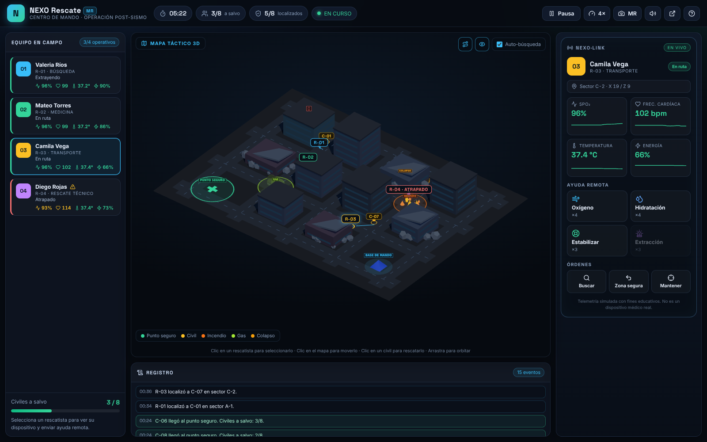
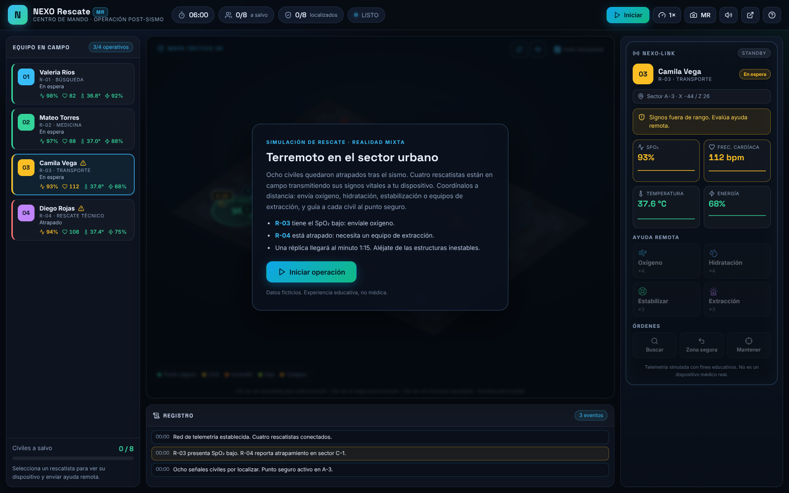
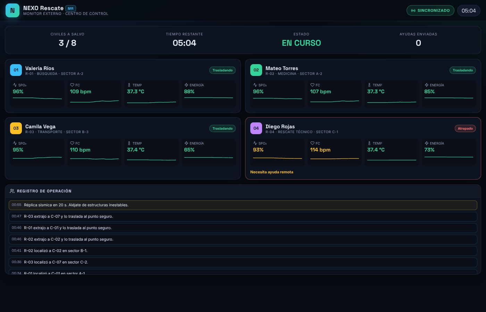

# NEXO Rescate MR — Centro de Mando

**Juego interactivo de realidad mixta (Merged / Mixed Reality) de rescate tras un terremoto.**

> Una ciudad ha colapsado. Cuatro rescatistas operan en el terreno mientras tú, a distancia,
> los coordinas desde un **dispositivo de telemetría**: ves en vivo su **SpO₂, frecuencia cardíaca,
> temperatura, energía, ubicación y estado** (atrapado, incapacitado, necesita ayuda), y decides
> **cómo resolver sus necesidades sin estar ahí**. Ellos buscan a los civiles atrapados y los
> trasladan a un **punto de encuentro seguro**.

Reescrito desde cero con **React + TypeScript + Three.js**. Sin CDN: todo se sirve localmente.



<details>
<summary>Más capturas</summary>





</details>

---

## 🎮 Cómo jugar

1. Abre la app y pulsa **▶ Iniciar operación** (o `Espacio`).
2. Selecciona un rescatista en el panel izquierdo, en el mapa 3D, o con las teclas `1`–`4`.
3. Desde el **dispositivo NEXO·LINK** (panel derecho) envía ayuda remota en dron:
   - 🫁 **Oxígeno** → sube el SpO₂ de un rescatista agotado o expuesto a gas.
   - 💧 **Hidratación** → baja temperatura y frecuencia cardíaca.
   - 🩺 **Estabilizar** → recupera energía y signos de un rescatista incapacitado.
   - 🚨 **Extracción** → libera a un rescatista atrapado bajo escombros.
4. Da órdenes: **Buscar**, **Zona segura**, **Mantener**, o haz clic en el mapa para moverlo
   y sobre un civil para asignar su rescate.
5. Los recursos son **limitados** y cada envío tarda unos segundos en llegar. Prioriza.

**Objetivo:** llevar a los **8 civiles** al punto seguro antes de que se agoten los **6 minutos**.
**Derrota:** tiempo agotado, o todo el equipo fuera de operación sin recursos de rescate.

### 🕹️ Controles

| Acción | Control |
|---|---|
| Seleccionar rescatista | Clic en su tarjeta / en el mapa · teclas `1`–`4` |
| Mover rescatista | Clic en una calle del mapa |
| Asignar rescate de civil | Clic sobre el marcador del civil |
| Orbitar / zoom / paneo | Arrastrar · rueda · clic derecho |
| Iniciar / pausar | `Espacio` |
| Ayuda | `H` |
| Velocidad | Botón `1× / 2× / 4×` |
| Realidad mixta | Botón `MR` (cámara como fondo) |
| Monitor externo | Botón ↗ o `monitor.html` en otra pestaña |

---

## 📟 El dispositivo — qué se puede ver

Cada rescatista transmite en vivo:

- ❤️ **Frecuencia cardíaca** (bpm) con historial.
- 🫁 **SpO₂** (%) — crítico en derrumbes y fugas de gas.
- 🌡️ **Temperatura corporal** (°C) — sube con el esfuerzo y cerca del incendio.
- ⚡ **Energía** (%) — se agota excavando y cargando civiles; se recupera en zona segura.
- 📍 **Ubicación** (sector y coordenadas en tiempo real).
- 🧱 **Atrapado** — por derrumbe o réplica sísmica.
- ⚠️ **Necesita ayuda** — alerta directa al operador.
- 🤚 **Trasladando civil** / **extrayendo**.

Umbrales por color: **verde** normal · **ámbar** advertencia · **rojo** crítico (con alerta sonora).

| Medida | Normal | Advertencia | Crítico |
|---|---|---|---|
| SpO₂ | ≥95 % | 90–94 % | <90 % |
| Frecuencia cardíaca | 55–110 bpm | 111–140 / 50–54 | >140 / <50 |
| Temperatura | <37.8 °C | 37.8–38.9 °C | ≥39 °C |
| Energía | >40 % | 21–40 % | ≤20 % |

> ⚠️ Todos los valores son **ficticios y educativos**. Esto no es un dispositivo médico.

---

## 🌍 El escenario

- Ciudad 3D isométrica con manzanas, calles, edificios dañados y **colapsados**.
- **8 civiles** ocultos al inicio: los rescatistas los **localizan**, **extraen** (más lento si
  están atrapados) y **cargan** hasta el punto seguro.
- **4 rescatistas** con roles: búsqueda, medicina, transporte y rescate técnico.
- **Peligros dinámicos:** 🔥 incendio (se extiende), ☣️ fuga de gas, 🧱 estructura inestable.
- **Réplica sísmica** al minuto 1:15: puede atrapar a quien siga cerca del colapso.
- Navegación **A\*** sobre grilla: los rescatistas rodean edificios y evitan peligros.
- **Búsqueda automática** (conmutable): el equipo elige al civil libre más cercano.

---

## 🕶️ Realidad Mixta

- **Modo MR**: `getUserMedia` coloca la cámara real como fondo y superpone el mapa táctico 3D
  y la telemetría. Es una aproximación de *merged reality* sin gafas especializadas.
- **Monitor externo** (`monitor.html`): pantalla de solo lectura sincronizada en vivo por
  `BroadcastChannel` con respaldo en `localStorage`. Ideal para segundo monitor o proyector.

---

## 🚀 Ejecutar

```bash
npm install
npm run dev        # http://localhost:5173
```

```bash
npm run build      # genera dist/
npm run preview    # sirve la build
npm test           # 17 pruebas del motor (vitest)
npm run smoke      # prueba de humo con navegador headless (requiere dev server activo)
```

Funciona en cualquier hosting estático (GitHub Pages, Netlify, etc.). La cámara requiere
**HTTPS** o `localhost`.

### GitHub Pages

El workflow `.github/workflows/deploy.yml` construye y publica `dist/` en cada push a `main`.
Activa Pages en *Settings → Pages → Source: GitHub Actions*.

---

## 📁 Estructura

```
src/
  game/         Motor de simulación puro (estado, vitals, A*, eventos, ayuda remota)
    engine.ts   GameEngine: tick, órdenes, drones, condiciones de victoria/derrota
    world.ts    Edificios, peligros, spawns, punto seguro
    pathfinding.ts  A* sobre grilla de navegación
    sync.ts     Publicación/suscripción al monitor externo
  scene/        Mapa 3D con Three.js (edificios, unidades, drones, peligros)
  components/   Paneles: equipo, dispositivo, registro, monitor, ayuda
  styles/       Tema visual del centro de mando
monitor.html    Entrada del monitor externo
```

El motor es independiente de la presentación: podría alimentarse con datos reales de un
dispositivo físico (BLE / Web Serial) sin cambiar la capa visual.

---

Hecho para **zharpinzon/Modelo3D** · 2026
